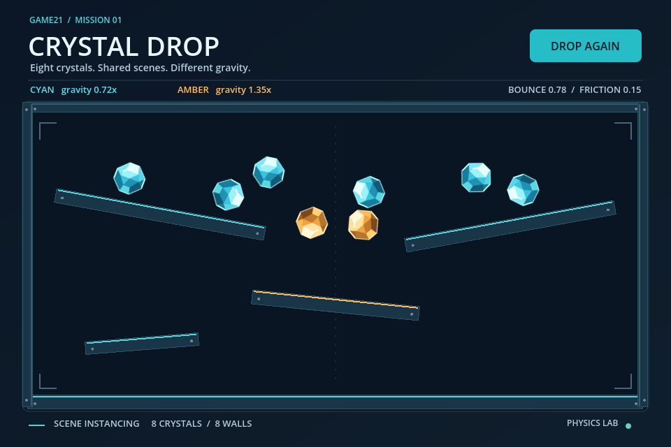

# GameLab2 — Crystal Drop & Star Courier

Two Godot 4.7.1 exercises exploring scene instancing, 2D physics and an arcade survival game for Computer Game Development Exercise 2.

| Project | Browser demo | Gameplay video |
| --- | --- | --- |
| **Game21: Crystal Drop** — falling crystals with different physics settings | [Play Game21](https://avocadough.github.io/GameLab2/game21.html) | [Watch Game21](https://avocadough.github.io/GameLab2/videos/game21.mp4) |
| **Game22: Star Courier** — dodge aliens and survive as long as possible | [Play Game22](https://avocadough.github.io/GameLab2/game22.html) | [Watch Game22](https://avocadough.github.io/GameLab2/videos/game22.mp4) |

## Open locally

Import [Game21/project.godot](Game21/project.godot) or [Game22/project.godot](Game22/project.godot) in Godot 4.7.1 and run its `Main.tscn`. Game22 uses a keyboard; its Web export requires a browser with WebGL 2 support.

- [Game21/](Game21/) — crystal and wall scenes with physics settings.
- [Game22/](Game22/) — player, mob, HUD and main scenes.
- [docs/](docs/) — Web exports, the submission landing page and videos.

The original exercise details, student identification, references and media credits are retained below.

---

## รายละเอียดแบบฝึกหัด (ภาษาไทย)

ภูริณัฐ ศรีไตรรัตน์ · 663380531-2

## ภารกิจ 1: Game21 — Crystal Drop

เปิด `Game21/project.godot` ด้วย Godot 4.7.1 แล้วเรียก `Main.tscn`

- เปลี่ยน Ball เป็นภาพคริสตัล SVG ที่วาดขึ้นใหม่ และใช้รูปชนแบบแปดเหลี่ยม
- ปรับ bounce เป็น 0.78, friction เป็น 0.15 และ mass เป็น 1.2
- คริสตัลสีฟ้าใช้ gravity scale 0.72; สีอำพัน override เป็น 1.35
- `Main.tscn` ใช้ `Ball.tscn` จำนวน 8 instances และ `Wall.tscn` จำนวน 8 instances
- กด **DROP AGAIN** เพื่อเริ่มการทดลองใหม่

อ้างอิง: [Creating instances — Godot](https://docs.godotengine.org/en/stable/getting_started/step_by_step/instancing.html)

## ภารกิจ 2: Game22 — Star Courier

เปิด `Game22/project.godot` ด้วย Godot 4.7.1 แล้วเรียก `Main.tscn`

- ดัดแปลงเกม Dodge the Creeps เป็นเกมหุ่นยนต์หลบเอเลียนในอวกาศ
- แยก `Player.tscn`, `Mob.tscn`, `HUD.tscn` และ `Main.tscn` ตามบทเรียน
- วาดฉาก ผู้เล่น และเอเลียนขึ้นใหม่ ใช้ภาพเคลื่อนไหวของผู้เล่นและศัตรู
- ใช้ปุ่มลูกศรหรือ **WASD** เคลื่อนที่; คลิก **START FLIGHT** หรือกด **Enter** เพื่อเริ่ม
- คะแนนเพิ่มตามเวลาที่รอดชีวิต เมื่อชนเอเลียนเกมจบ และกด **TRY AGAIN** เพื่อเริ่มใหม่
- แสดงชื่อและรหัสนักศึกษาภายในเกม

อ้างอิง: [Your first 2D game — Godot](https://docs.godotengine.org/en/stable/getting_started/first_2d_game/01.project_setup.html)

## Web และ VDO

เผยแพร่ GitHub Pages จาก branch `main` โฟลเดอร์ `/docs`

| ช่องส่งงาน | ไฟล์ |
|---|---|
| ภารกิจ 1 — ตัวอย่าง VDO | `docs/videos/game21.mp4` |
| ภารกิจ 1 — GitHub Page | `docs/game21.html` |
| ภารกิจ 2 — ตัวอย่าง VDO | `docs/videos/game22.mp4` |
| ภารกิจ 2 — GitHub Page | `docs/game22.html` |

`docs/index.html` รวมลิงก์ทั้งสองภารกิจพร้อมชื่อและรหัสนักศึกษา

Web exports ใช้ Compatibility renderer และ single-thread เพื่อเปิดบน GitHub Pages ได้โดยไม่ต้องตั้ง HTTP headers เพิ่ม ใช้เบราว์เซอร์ที่รองรับ WebGL 2 และคีย์บอร์ดสำหรับ Game22

## แหล่งที่มาของสื่อ

ภาพ SVG และเสียงในงานนี้สร้างขึ้นสำหรับแบบฝึกหัดนี้ ฟอนต์ Noto Sans Thai มาจาก [Google Fonts](https://github.com/google/fonts/tree/main/ofl/notosansthai) ภายใต้ SIL Open Font License; สำเนาใบอนุญาตอยู่ที่ `Game22/fonts/OFL.txt`
